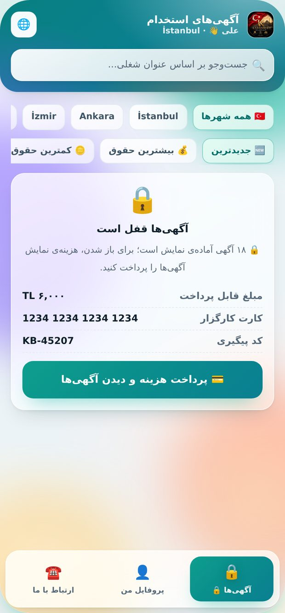
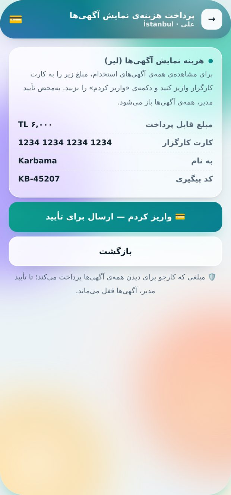
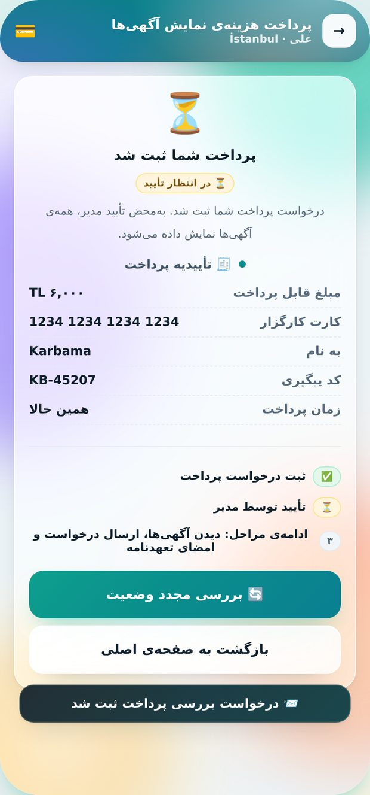
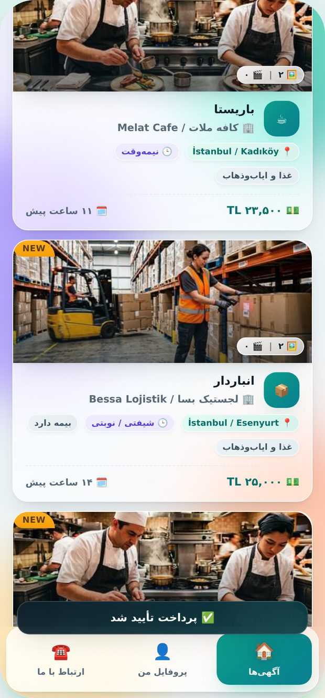

# کارباما | Karbama 🇹🇷

اپلیکیشن کاریابی برای فارسی‌زبانان و مهاجران در ترکیه — همراه با یک **دموی وب کاملاً کلیک‌کردنی** از همان محصول.

<p align="center">
  
</p>

---

## این پروژه چیست؟

| بخش | توضیح |
|---|---|
| **اپ اندروید** | Kotlin + Jetpack Compose، چهار زبان (فارسی · Türkçe · English · العربية)، راست‌به‌چپ کامل، Firebase اختیاری |
| **دموی وب** | یک فایل HTML مستقل (`karbama-demo.html`) با همان جریان کامل برنامه — برای دیدن و تست بدون نصب |
| **پنل مدیریت** | آگهی‌ها، متقاضیان، وضعیت پرداخت، تنظیمات کارگزار، ورود دومرحله‌ای (2FA) |
| **تست خودکار** | ۱۷ سوئیت تست (کلیکی با مرورگر + بدون مرورگر) در `kb-tools/` |

## امکانات کلیدی

- **ثبت‌نام چهارمرحله‌ای** با نام پدر، کد ملی، محل سکونت و بارگذاری پاسپورت
- **تعهدنامه‌ی تسویه حساب هزینه کارگزار** — صفحه‌ی مستقل A4، امضای الکترونیکی، تاریخ قرارداد = روز ثبت‌نام
- **آگهی‌ها با عکس و ویدیو**، جست‌وجو و فیلتر بر اساس شهر/منطقه/ترتیب حقوق
- **قفل آگهی‌ها تا پرداخت هزینه** — کارجو تا پرداخت «هزینه نمایش آگهی‌ها» و **تأیید مدیر** هیچ آگهی‌ای نمی‌بیند
- **«پسندیده»** و **درخواست‌های ارسالی** — روی گوشی و هم‌گام با Firestore
- **ورود یکپارچه** — مدیر و کارجو با یوزرنیم/پسورد، بدون دکمه‌ی جداگانه
- **۲FA برای مدیر** با TOTP استاندارد + کد بازیابی

## مسیر پرداخت (آخرین تغییر)

صفحه‌ی اصلی **همان صفحه‌ی قبلی** می‌ماند (سرتیتر، جست‌وجو، فیلترها) و فقط بخش آگهی‌ها پوشیده می‌شود:

```
صفحه‌ی اصلی (آگهی‌ها قفل)  →  صفحه‌ی پرداخت  →  «واریز کردم»
        →  تأییدیه پرداخت (در انتظار تأیید مدیر)  →  تأیید مدیر  →  آگهی‌ها باز
```

| مرحله | تصویر |
|---|---|
| صفحه‌ی اصلی با آگهی‌های پوشیده |  |
| صفحه‌ی پرداخت |  |
| تأییدیه پرداخت و ادامه مراحل |  |
| بعد از تأیید مدیر |  |

## اجرای سریع

**دموی وب (بدون هیچ نصب):**
```bash
# فقط فایل را در مرورگر باز کنید
open karbama-demo.html
# یا با یک سرور محلی
python3 -m http.server 8081
```

**اپ اندروید:**
```bash
cd Karbama
./gradlew :app:assembleDebug     # خروجی: app/build/outputs/apk/debug/app-debug.apk
```
> در CI از JDK 17 و Android SDK 36 استفاده می‌شود (JDK سازگارِ جدیدتر هم قابل استفاده است). جزئیات در [`Karbama/README.md`](Karbama/README.md).

**داده‌های واقعی (اختیاری):** راهنمای فارسی اتصال Firebase در [`Karbama/FIREBASE-SETUP-fa.md`](Karbama/FIREBASE-SETUP-fa.md) — بدون Firebase هم برنامه آفلاین کار می‌کند.

## ساختار مخزن

```
Karbama/                  پروژه‌ی اندروید (Kotlin + Compose)
  app/src/main/java/...   کد اپ (screens / data / ui)
  firestore.rules         قواعد امنیتی Firestore
  storage.rules           قواعد امنیتی Storage
  FIREBASE-SETUP-fa.md    راهنمای اتصال Firebase
karbama-demo.html         دموی وب کلیک‌کردنی (بدون وابستگی)
download/index.html       صفحه‌ی دانلود APK
kb-tools/                 تست‌های خودکار و اسکریپت‌های بازرسی طراحی
docs/CHANGELOG-fa.md      تاریخچه‌ی کامل تغییرات
docs/screenshots/         تصاویر مستند
```

## تست‌ها

```bash
cd kb-tools
node extract-demo.js && node --check demo.js
node check-35-payflow.js      # مسیر پرداخت — ۳۲ ✅
node check-28.js              # رگرسیون — ۲۵ ✅
node check-33-design.js       # خوانایی و طراحی — ۹ ✅
```

## امنیت

- `firestore.rules`: کارجو **نمی‌تواند** خودش را «پرداخت‌شده» اعلام کند؛ تأیید پرداخت فقط با `isAdmin()`
- خواندن پسندیده‌ها و درخواست‌ها فقط برای صاحب سند یا مدیر
- آپلود رسانه‌ی آگهی فقط برای مدیر و با محدودیت نوع/حجم

## نسخه‌ها

APK نسخه‌ی نهایی و تاریخچه‌ی تغییرات در بخش **Releases** همین مخزن قرار می‌گیرد.
تاریخچه‌ی متنی کامل: [`docs/CHANGELOG-fa.md`](docs/CHANGELOG-fa.md)

---

<p align="center"><sub>powered by naser tavakkoli @nt.galaxy</sub></p>
